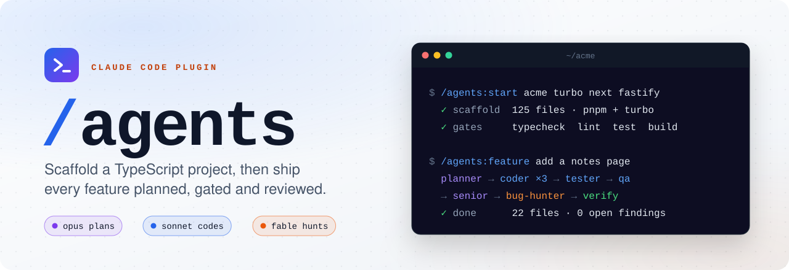
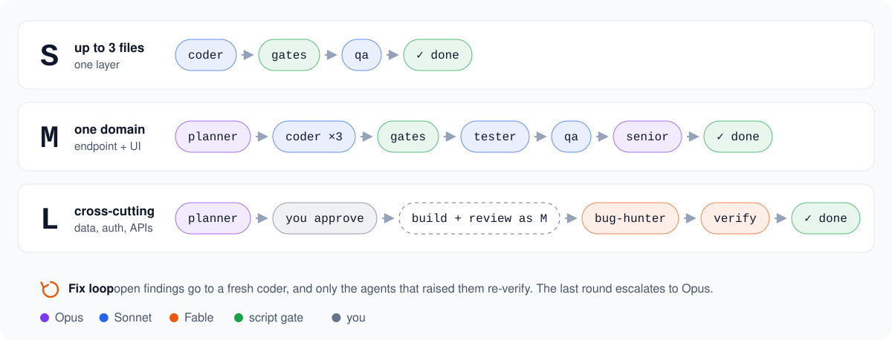

<div align="center">

<picture>
  <source media="(prefers-color-scheme: dark)" srcset="docs/assets/banner-dark.svg">
  
</picture>

<br>

[](https://github.com/tiago-o-pinheiro/agents-workflow/actions/workflows/ci.yml)
[](#install)
[](#before-you-start)
[](skills/conventions/SKILL.md)
[](LICENSE)

**One wizard creates the project with its rules built in.**<br>
**One command takes a request from plan to a reviewed, gated diff.**

[Install](#install) · [Commands](#three-commands) · [Pipeline](#the-pipeline) · [Stacks](#stacks) · [Cost](#what-it-costs) · [Agents](#the-agents)

</div>

<br>

## Install

```text
/plugin marketplace add tiago-o-pinheiro/agents-workflow
/plugin install agents@team
```

That's it. The plugin adds about **500 tokens** to each session; everything else loads only when a command or agent runs. Update later with `/plugin marketplace update team`.

> [!TIP]
> On a new machine, those two lines are the whole setup. Prefer plain files? Use the [install script](#install-without-the-marketplace) instead.

<br>

## Three commands

| Command | When | What happens |
|:--|:--|:--|
| **`/agents:start`** | New project | A short wizard picks the stack, composes the project from tested templates, runs the gates, then lets coder agents apply the recipes you chose (database, auth, UI kit, state). |
| **`/agents:feature`** | Any change | Triages the request into **S**, **M** or **L** and runs only as much process as the change deserves: plan, code, test, review, bug hunt. |
| **`/agents:adopt`** | Existing repo | Adds the conventions docs, the gate script and the pipeline config without overwriting anything, so `/agents:feature` works there too. |

```text
/agents:start acme turbo next fastify zod          words after the name prefill the wizard
/agents:start blog --defaults                      skip the questions

/agents:feature add a notes list with a create form
/agents:feature add rate limiting to the API --tier L
/agents:feature fix the header date format --tier S --profile budget
/agents:feature --resume                           continue an interrupted run
```

Bare names (`/start`, `/feature`) also work as long as no other skill claims them.

<br>

## The pipeline

<picture>
  <source media="(prefers-color-scheme: dark)" srcset="docs/assets/pipeline-dark.svg">
  
</picture>

- **Gates before opinions.** Typecheck, lint, test and build run before any model reviews the code, so expensive reviewers never read broken code.
- **Fresh context per step.** Each agent starts clean and reads only what its step needs: the plan, the diff, the open findings.
- **Bugs need proof.** The bug-hunter only reports with a failing spec or exact repro steps. The specs stay as regression tests.
- **Resumable.** Run state lives in `.dev/runs/`, so `--resume` picks up after `/clear` or an interruption.
- **Honest ending.** You see the summary and a proposed conventional commit, then choose: commit, commit on a new branch, or leave it uncommitted. Nothing is ever pushed.

<br>

## Stacks

Every option below is scaffolded from templates that pass their own typecheck, lint, test and build. CI rebuilds a 10-combination matrix on every template change. **Bold** is the default.

| Layer | Options |
|:--|:--|
| **Frontend** | Next.js (App Router) · Vite + React Router · none |
| **Backend** | Next.js built-in · Fastify · Hono · Express · none |
| **Validation** | **TypeBox** · Zod |
| **Database** | Prisma + Postgres · Drizzle + Postgres · **none** |
| **Auth** | Better Auth · Google OAuth to JWT · Auth.js (Next only) · **none** |
| **UI** | **Tailwind + own components** · Tailwind + shadcn/ui |
| **State** | **Context + hooks** · TanStack Query · Zustand |
| **Layout** | **Auto** · single app · pnpm + Turborepo · Bun workspaces |
| **Extras** | **Git hooks** · **Claude lint-on-edit hook** · GitHub Actions CI · i18n |

<details>
<summary><b>What the conventions enforce</b></summary>
<br>

- Strict TypeScript: no `any`, no `as`, no `!`, `type` over `interface`, no enums, arrow functions and named exports.
- Layered backend: router, then controller, then service. One error class hierarchy, one typed env module, no ORM calls in controllers (a lint rule blocks them).
- Hooks return at most 4 values and are never wrapped in other hooks. A custom lint rule enforces both, so no review tokens are spent on them.
- Design system split: tokens, then a Tailwind contract, then the ui package. Components use token utilities only.
- Colocated specs named `Given ..., should ...`, user-event driven, no mocking of your own modules.

The rules live in [`skills/conventions`](skills/conventions/SKILL.md) and are copied into every generated project as `docs/conventions/`.

</details>

<details>
<summary><b>What gets generated</b></summary>
<br>

```text
single app                              monorepo
acme/                                   acme/
├─ src/          app code by layer      ├─ apps/web  apps/api
├─ docs/conventions/                    ├─ packages/models  ui  tokens  config ...
├─ scripts/check.mjs   gate runner      ├─ docs/conventions/  scripts/check.mjs
├─ .dev/config.json    pipeline config  ├─ .dev/config.json
└─ CLAUDE.md     under 100 lines        └─ turbo.json  pnpm-workspace.yaml  CLAUDE.md
```

</details>

<br>

## What it costs

Measured on a scaffolded Next.js app, orchestrator on Opus, balanced profile.

| Tier | Flow | Example | Time | Cost |
|:-:|:--|:--|--:|--:|
| **S** | coder, qa | rename a UI label (2 files) | ~1.5 min | **~$0.45** |
| **M** | planner, coders, tester, qa, senior | endpoint, model and UI footer (12 files) | ~6.5 min | **~$1.35** |
| **L** | M plus bug-hunter | notes API and page with filter, pagination, form (22 files) | ~12 min | **~$6.50** |

About 70% of the cost is the Opus orchestrator, planner and senior review; Sonnet coders, tester and QA are the rest. S and M needed no fix rounds; the L run had two (a gate failure and two bug-hunter findings) and was interrupted and finished with `--resume`. Each fix round adds roughly one coder plus the reviewers that verify it.

<details>
<summary><b>Where the tokens are saved</b></summary>
<br>

- Cheap models for cheap work: Opus plans and judges design, Sonnet writes code, Haiku is available for budget runs.
- Agents pass file paths to each other, never file contents. Reports are capped at 150 words.
- Gates run first, with filtered output; reviewers read only the diff, and fix rounds only the fix diff.
- Conventions load on demand; the generated `CLAUDE.md` points to docs instead of repeating them.

</details>

<br>

## The agents

| Agent | Model | Role |
|:--|:--|:--|
| **planner** | Opus | Writes `plan.md`: acceptance criteria, contracts, tasks grouped for parallel coders |
| **coder** | Sonnet | Implements tasks and fixes with colocated specs; consults the architect on open design choices |
| **architect** | Opus | Consultant for hard decisions; never edits |
| **tester** | Sonnet | At least one test per acceptance criterion |
| **qa** | Sonnet | Checks the diff against the conventions checklist and the criteria |
| **senior-reviewer** | Opus | Design fit, layering, security, data integrity |
| **bug-hunter** | Fable | Adversarial; every finding comes with a failing spec or exact repro |

<details>
<summary><b>Model profiles</b> (<code>--profile</code> or <code>.dev/config.json</code>)</summary>
<br>

| Agent | quality | balanced (default) | budget |
|:--|:--|:--|:--|
| planner | Opus | Opus | Sonnet |
| coder | Sonnet, high effort | Sonnet | Sonnet |
| tester, qa | Sonnet | Sonnet | Haiku |
| senior-reviewer | Opus | Opus | Sonnet |
| bug-hunter | Fable | Fable | Opus |
| architect | Opus | Opus | Opus |

</details>

<br>

## More

<details id="before-you-start">
<summary><b>Before you start</b></summary>
<br>

- Node 22 or newer
- `corepack enable pnpm`
- Bun, only for Bun workspaces
- Docker, only for the database recipes
- Claude Code

</details>

<details id="install-without-the-marketplace">
<summary><b>Install without the marketplace</b></summary>
<br>

```text
git clone https://github.com/tiago-o-pinheiro/agents-workflow ~/agents-workflow
~/agents-workflow/install.sh
```

The script symlinks the skills and agents into `~/.claude` and gives bare command names (`/start`, `/feature`, `/adopt`). Flags: `--dry-run`, `--force` (backs up conflicts), `--uninstall`. Use either the plugin or the script, not both, or every command appears twice.

</details>

<details>
<summary><b>Repo layout</b></summary>
<br>

```text
.claude-plugin/      plugin and marketplace manifests
agents/              the seven agents
skills/start/        wizard, scaffold.mjs, templates, recipes
skills/feature/      orchestrator, run.mjs, check.mjs, protocol
skills/conventions/  the coding rules
skills/adopt/        overlay for existing repos
scripts/             validate-repo.mjs
tests/               unit tests and smoke.sh
docs/                architecture.md, README assets
install.sh           symlink installer
```

Contracts: [docs/architecture.md](docs/architecture.md) for the scaffold, [protocol.md](skills/feature/references/protocol.md) for the pipeline.

</details>

<details>
<summary><b>Develop the plugin</b></summary>
<br>

```text
node scripts/validate-repo.mjs     line budgets, frontmatter, links, private words
node --test tests/*.test.mjs       unit tests
bash tests/smoke.sh                scaffold and build every stack combination
claude --plugin-dir .              try the plugin from a checkout
```

</details>

<details>
<summary><b>Credits</b></summary>
<br>

Ideas borrowed, with thanks:

- [obra/superpowers](https://github.com/obra/superpowers): fresh implementer per task, capped fix rounds, escalation, rulings ledger.
- [anthropics/claude-code](https://github.com/anthropics/claude-code) `feature-dev`: explorers that return key files, confidence-filtered read-only review.
- [anthropics/claude-plugins-official](https://github.com/anthropics/claude-plugins-official) `pr-review-toolkit`: silent-failure and type-design hunters as models for the bug-hunter.
- [gsd-build/get-shit-done](https://github.com/gsd-build/get-shit-done): model profiles and plan and state files on disk.
- [github/spec-kit](https://github.com/github/spec-kit): one constitution that encodes the rules once.
- [EveryInc/compound-engineering-plugin](https://github.com/EveryInc/compound-engineering-plugin): learnings captured after runs and read by the planner.
- [OthmanAdi/planning-with-files](https://github.com/OthmanAdi/planning-with-files): run state on disk that survives `/clear`.
- [JuliusBrussee/caveman](https://github.com/JuliusBrussee/caveman): terse inter-agent reports and filtered output.
- [yamadashy/repomix](https://github.com/yamadashy/repomix): a compact repo map for the planner.
- [AmanVarshney01/create-better-t-stack](https://github.com/AmanVarshney01/create-better-t-stack): the wizard's option matrix.
- [shadcn-ui/ui](https://github.com/shadcn-ui/ui) and [vercel/turborepo](https://github.com/vercel/turborepo): monorepo and design-system layout.

</details>

<br>

<div align="center">
<sub>MIT licensed. See <a href="LICENSE">LICENSE</a>.</sub>
</div>
